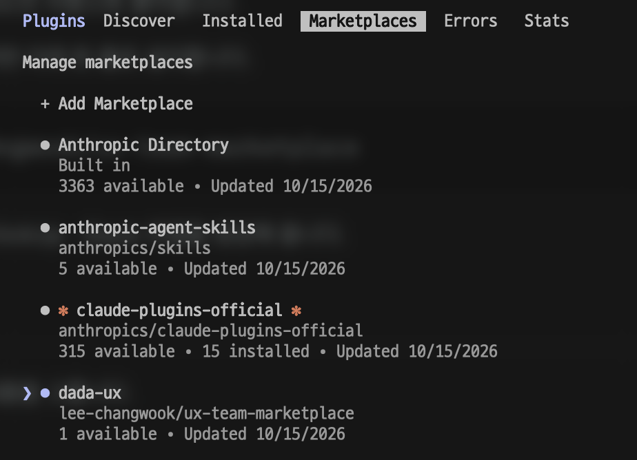
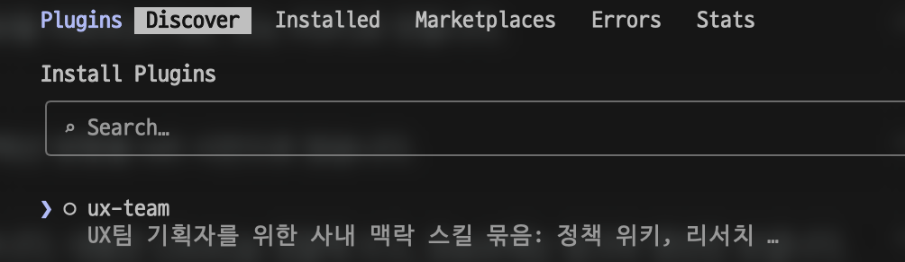
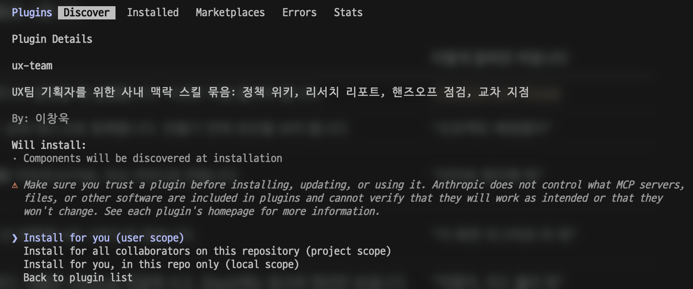

# dada-ux 마켓플레이스

다다 UX팀 기획자를 위한 Claude 플러그인 `ux-team`입니다.
Claude 앱(Chat · Cowork)과 Claude Code에서 같은 스킬을 씁니다.

## 설치

### Claude 앱 (Chat · Cowork)

1. Customize › Plugins › Add › Add marketplace를 엽니다.
2. `lee-changwook/ux-team-marketplace`를 입력합니다.
3. 목록에 나온 `ux-team`을 설치합니다.
4. 마켓플레이스의 Sync automatically를 켜 둡니다. 새 버전이 나오면 자동으로 들어옵니다.

앱에서 설치했다면 Claude Code에도 따라오므로 따로 설치하지 않아도 됩니다.

### Claude Code

1. `/plugin`을 열고 Marketplaces › Add Marketplace에 `lee-changwook/ux-team-marketplace`를 입력합니다. 목록에 `dada-ux`가 생깁니다.

   

2. Discover 탭에서 `ux-team`을 고릅니다.

   

3. Install for you (user scope)를 고릅니다.

   

명령 한 줄로 설치해도 됩니다.

```
/plugin install ux-team --marketplace lee-changwook/ux-team-marketplace
```

### 설치한 뒤

`/hello-ux-team`을 한 번 실행합니다.
팀 지침을 넣고, 커넥터 연결을 점검해 줍니다.

## 스킬

대부분 상황이 맞으면 알아서 켜집니다.
직접 부르려면 `/`를 치고 스킬 이름을 고릅니다.

| 스킬 | 하는 일 | 이렇게 말하면 켜집니다 |
|---|---|---|
| `hello-ux-team` | 설치하고 처음 한 번, 리드가 팀 지침이 바뀌었다고 알렸을 때 실행합니다. 이것만 직접 불러야 합니다. | `/hello-ux-team` |
| `kickoff` | 배정받은 프로젝트를 ClickUp 팀 스페이스에 상위 태스크로 등록합니다. 만들기 전에 초안을 보여 줍니다. | "프로젝트 배정됐어" |
| `research-report` | 인터뷰 · 설문 · 현장 테스트 메모를 팀에 공유할 리포트(HTML 또는 PDF)로 만듭니다. | "인터뷰 정리해 줘" |
| `screen-to-hifi` | staging 화면을 Figma로 가져와, 말로 준 개선 방향을 hifi 시안으로 얹습니다. | "이 화면 피그마로 떠 줘" |
| `call-lead` | 프로토타입을 만들다 막혔을 때 리드를 부릅니다. 내용은 ClickUp 댓글에 쓰고, Slack에는 링크와 멘션만 보냅니다. | "막혔어, 리드 불러 줘" |
| `handoff-check` | 개발로 넘기기 전에 기획 글과 프로토타입이 맞는지, 정하지 못한 것이 표시됐는지 점검합니다. | "넘기기 전에 확인해 줘" |
| `intent-check` | staging에 올라간 화면이 기획 의도대로인지 보고 차이 목록을 만듭니다. 화면이나 데이터는 건드리지 않습니다. | "의도대로 구현됐는지 봐 줘" |
| `decision-log` | 기획 중 정해진 결정을 누가 · 언제 · 왜 정했는지와 함께 ClickUp에 남깁니다. 남기기 전에 초안을 보여 줍니다. | "이거 결정됐어, 기록해 줘" |
| `feature-guide` | 새 기능을 원장님 · 행정팀 · 강사님께 안내하는 사용 설명서 PDF를 만듭니다. 화면 문구를 코드에서 가져와서 Claude Code에서만 됩니다. | "사용 설명서 만들어 줘" |
| `artifact-style` | 아티팩트나 HTML 페이지에 UX팀 공용 디자인과 글쓰기 규칙을 입힙니다. | "진행 현황을 HTML 페이지로 만들어 줘" |
| `tikita-policy` | 준비 중입니다. 정책 위키가 연결되면 티키타 정책을 찾아 근거와 함께 답합니다. 지금은 정책을 지어내지 않고 "미결"로 남깁니다. | "출결에서 지각과 결석은 어떻게 달라?" |

## 미리 연결할 것

ClickUp · Slack · Figma는 Claude 앱의 Customize › Connectors에서 각자 자기 계정으로 연결합니다.
Claude Code에는 앱에서 연결한 커넥터가 따라오고, 새 세션을 열 때 붙습니다.

| 커넥터 | 쓰는 스킬 |
|---|---|
| ClickUp | `kickoff` · `decision-log` · `call-lead` |
| Slack | `call-lead` |
| Figma | `screen-to-hifi` |

빠진 커넥터는 `/hello-ux-team`이 알려 줍니다.
staging 화면을 여는 `screen-to-hifi` · `intent-check`는 WireGuard VPN을 켜 둬야 합니다.

더 자세한 안내: https://claude.ai/artifact/A39pdxytvgJuhiac7Vw3ba
