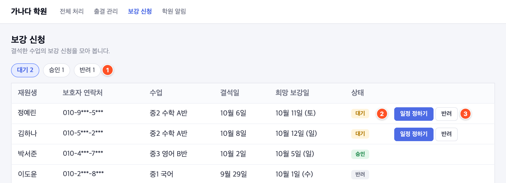
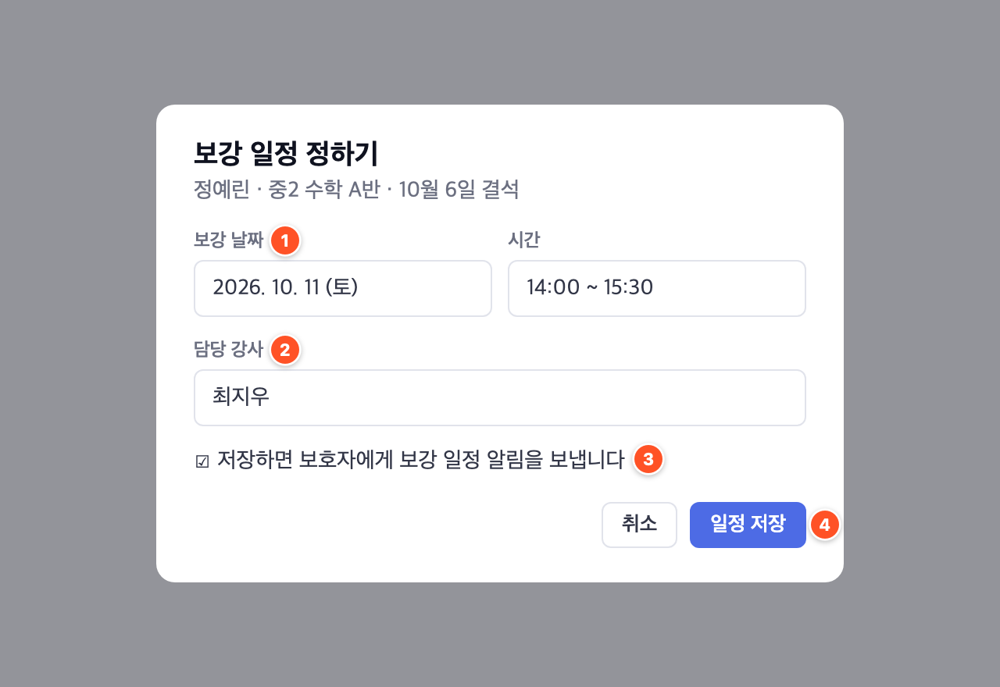

### 보강 신청은 이 화면에서 처리합니다

1. **상태별로 보기** — `대기` · `승인` · `반려`를 누르면 그 상태의 신청만 나옵니다. 옆 숫자는 건수입니다.
2. **일정 정하기** — 대기 중인 신청의 보강 날짜와 강사를 정합니다. 저장하면 `승인`으로 바뀝니다.
3. **반려** — 보강을 해 드릴 수 없는 신청을 반려합니다.

> 보호자 연락처는 화면에 그대로 나옵니다. 화면을 캡처해 밖으로 보내실 때는 연락처를 가려 주세요.

## 1단계 · 보강 일정 정하기

대기 중인 신청 줄에서 `일정 정하기`를 누르면 아래 창이 뜹니다.

{side=55%}

1. `보강 날짜`와 `시간`을 고릅니다. 날짜는 처음에 보호자가 고른 희망 보강일로 채워져 있습니다.
2. `담당 강사`에서 보강을 맡을 강사를 고릅니다.
3. 체크되어 있으면 저장할 때 보호자에게 보강 일정 알림이 갑니다. 알림을 보내지 않으려면 체크를 끕니다.
4. `일정 저장`을 누르면 화면 위에 `보강 일정을 저장했습니다.`가 뜨고, 신청이 `승인`으로 옮겨 갑니다.

## 2단계 · 반려하기

보강을 해 드릴 수 없는 신청은 반려합니다.

1. 대기 중인 신청 줄에서 `반려`를 누릅니다.
2. `이 보강 신청을 반려할까요?` 창에서 `반려하기`를 누릅니다. 신청이 `반려`로 옮겨 갑니다.

> 반려 사유를 적는 칸은 없습니다. 보호자께는 따로 연락해 주세요.

## 이럴 땐 이렇게

### 일정을 저장했는데 보호자가 알림을 못 받았대요

창 아래 `저장하면 보호자에게 보강 일정 알림을 보냅니다`의 체크가 꺼져 있었다면 알림이 가지 않습니다.
체크를 켠 채 저장했는데도 받지 못했다면 고객지원팀으로 문의해 주세요.

### 승인한 신청의 일정을 바꾸고 싶어요

이 화면에서는 대기 중인 신청만 일정을 정할 수 있습니다.
승인한 뒤 일정을 바꾸는 방법은 고객지원팀으로 문의해 주세요.
